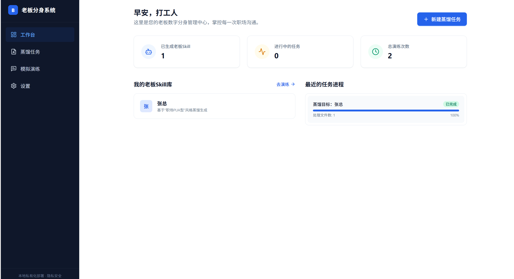

# 💼 老板数字分身系统 (Boss Digital Avatar)

这是一个基于本地大模型（Ollama）的“老板数字分身”蒸馏与模拟平台。通过上传真实的聊天记录和文件，提取老板的话术、思维方式与性格特征，生成对应的“老板Skill”，并在安全隔离的本地环境中进行沙盘推演，帮助打工人预测老板行为、寻求最佳应对策略。

## ✨ 核心特性

*   **100% 隐私安全**：纯前端架构，无云端服务器，所有数据和聊天记录均保存在您的浏览器本地（Local Storage）。
*   **本地大模型驱动**：对接本地 Ollama API，利用本地算力进行模型“蒸馏”和多轮对话。
*   **AI 实时意图分析**：在演练对话中，AI 会自动剖析老板发言背后的真实意图，并给出“高情商回复建议”。
*   **多任务管理**：支持多个蒸馏任务并行，并提供进度实时展示。
*   **沉浸式办公 UI**：采用简约商务风设计，类似主流企业级 SaaS 平台。

## 📸 项目截图

将截图放到仓库后，即可在 README 中展示。建议把截图统一放在 `docs/screenshots/` 目录下，命名为：
- `distill-step1.png`
- `distill-done.png`
- `settings.png`
- `chat.png`

示例（你把文件放好并提交后，把下面的路径改成实际文件名即可）：


如果你希望控制图片宽度（GitHub 支持 HTML 标签），可以这样写：

```html

```

如果你不想把图片放到仓库，也可以把图片上传到 GitHub（例如发 Issue/PR 时直接拖拽上传），然后用 GitHub 生成的图片链接粘贴到 README 中即可。

---

## 📸 项目截图 (Screenshots)

这里展示了系统的核心交互界面。

> **💡 给贡献者/开发者的提示（如何在 GitHub 替换图片）：**
> 您只需要把自己的截图保存在项目根目录的 `docs/screenshots/` 文件夹下，然后在下方代码中把图片文件名（如 `dashboard.png`）替换成您自己的即可。

<div align="center">
  
  <p><em>图 1: 在“系统设置”中配置您的本地 Ollama 模型服务</em></p>
</div>

<br/>

<div align="center">
  
  <p><em>图 2: 工作台概览，管理和查看所有的“老板数字分身”及进度</em></p>
</div>

<br/>

<div align="center">
  
  <p><em>图 3: 新建蒸馏任务：选择预设的 Boss 人设模板</em></p>
</div>

<br/>

<div align="center">
  
  <p><em>图 4: 蒸馏完成，模型提取成功</em></p>
</div>

<br/>

<div align="center">
  
  <p><em>图 5: 随时随地发起一次与 Boss 的“沙盘演练”</em></p>
</div>

<br/>

<div align="center">
  
  <p><em>图 6: 聊天实战演练，右侧面板提供 <b>真实意图剖析</b> 与 <b>高情商回复建议</b></em></p>
</div>

---

## 🚀 快速启动与打包客户端指南

本项目不仅支持在浏览器中运行网页版，还支持**一键打包为独立的桌面客户端（Windows/Mac/Linux）**，让您可以双击图标直接启动，享受更沉浸的桌面级体验！

### 准备工作

无论您是要运行网页版还是打包客户端，都需要：
1. **确保已安装 Node.js** (推荐 v18 或以上版本)。
2. 在项目根目录下打开终端，安装所有依赖（包括前端和 Electron 相关依赖）：
```bash
npm install
```

### 选项一：作为桌面客户端运行/打包 (✨ 推荐)

**在开发模式下启动客户端（带热更新）：**
```bash
npm run electron:dev
```
这会自动启动前端服务，并弹出一个独立的软件窗口。

**一键打包为独立安装包：**
```bash
npm run electron:build
```
打包完成后，您可以在项目根目录的 `release` 文件夹中找到生成的安装包（例如 Windows 的 `.exe` 或 Mac 的 `.dmg`）。双击安装即可！

---

### 选项二：作为普通网页版运行

**启动本地开发服务器：**
```bash
npm run dev
```
终端会输出一个本地访问地址（通常是 `http://localhost:5173/`），在浏览器中打开即可。

---

### ⚠️ 关键步骤：启动本地 Ollama 服务

因为本项目是纯前端应用，浏览器直接请求本地运行的 Ollama API，因此**必须配置跨域（CORS）权限**，否则前端无法连接大模型。

根据您的操作系统，按以下步骤启动 Ollama：

#### 🍏 Mac / Linux
打开一个新的终端窗口，设置环境变量并启动：
```bash
OLLAMA_ORIGINS="*" ollama serve
```

#### 🪟 Windows (PowerShell)
打开 PowerShell 终端，设置环境变量并启动：
```powershell
$env:OLLAMA_ORIGINS="*"
ollama serve
```
*(注意：如果您之前已经让 Ollama 在后台静默运行了，请先在系统托盘右下角退出 Ollama 图标，然后再用上述命令行方式重新启动它。)*

### 第三部分：准备基座模型

确保您的 Ollama 中已经拉取了在系统“设置”页面中配置的基座模型（默认配置为 `llama3.2`）。如果您还没有下载模型，可以在终端运行：

```bash
ollama run llama3.2
```
*(当然，您也可以使用您本地已有的其他模型如 `qwen2` 等，只需在前端平台的“设置”页面同步修改即可。)*

---

## 🛠️ 使用流程建议

1.  **连接测试**：打开前端页面后，首先进入 **“设置”** 页面，点击“测试连接”。如果显示“连接成功！”，说明您的 Ollama 跨域配置正确。
2.  **创建分身**：进入 **“蒸馏任务”** 页面，填写名称，选择预设模板（如“画大饼型”、“职场PUA型”），上传相关文件或截图，点击“开始蒸馏”。
3.  **沙盘演练**：蒸馏完成后，前往 **“模拟演练”** 页面，选择生成的 Boss Skill 发起对话。
4.  **高情商辅助**：在对话中，注意查看右侧的 **“AI 实时分析”** 面板，获取老板的真实意图和高情商回复建议。

## 🏗️ 技术栈

*   **框架**: React 18 + Vite
*   **样式**: Tailwind CSS 3
*   **状态管理**: Zustand (带 LocalStorage 持久化)
*   **路由**: React Router v6
*   **图标**: Lucide React
*   **Markdown 渲染**: react-markdown

## 🧭 开源到 GitHub（简明教程）

### 1) 开源前检查清单（很重要）
- 不要提交真实的聊天截图、真实姓名、手机号、公司信息等敏感内容
- 不要提交任何密钥（例如 `.env`、token、API key、数据库账号密码）
- 确认 `README.md` 的启动流程在你的电脑上能跑通

### 2) 初始化仓库并推送

在项目根目录执行：

```bash
git init
git add .
git commit -m "init: boss digital avatar"
```

去 GitHub 新建一个空仓库（不要勾选添加 README），然后执行：

```bash
git branch -M main
git remote add origin https://github.com/<your-name>/<your-repo>.git
git push -u origin main
```

## 📝 更新日志

更新记录请查看 [UPDATE.md](file:///workspace/UPDATE.md)。

## 🤝 贡献

欢迎提交 Issue / PR。建议优先从以下方向完善：
- 真正的“蒸馏链路”（OCR/文本解析 → 结构化特征 → Modelfile 生成/管理）
- RAG（检索增强生成）：老板语料的向量检索与引用
- 更完善的任务队列与失败重试机制
- 桌面端一键启动/检测 Ollama 服务

## 📄 License

建议你在开源前选择一个许可证（MIT / Apache-2.0 / GPL 等），并在仓库根目录添加 `LICENSE` 文件。MIT 适合大多数开源工具型项目。
